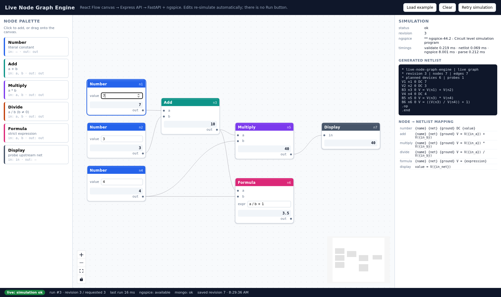

# Live Node Graph Engine

Browser-based visual node-graph editor whose graphs are executed **for real**: React Flow canvas → Express API →
FastAPI → `ngspice -b` → numbers back on the nodes. Every edit re-simulates; there is no Run button.

**Stack** React · TypeScript · Vite · `@xyflow/react` · Node + Express · Python + FastAPI · ngspice (batch) ·
MongoDB · Docker Compose.



## Architecture

```
browser (nginx :5173)         api (Express :4000)          simulation (FastAPI :8000)      mongo (:27017)
┌──────────────────┐   /api  ┌────────────────┐    HTTP    ┌────────────────────────┐   ┌────────────┐
│ React Flow canvas│ ───────▶│ routes + Mongo │ ─────────▶ │ validate → netlist →   │   │ graphs     │
│ live-sync engine │◀─────── │ repository     │◀─────────  │ ngspice -b → parse     │   │ document   │
└──────────────────┘ results └────────────────┘  results   └────────────────────────┘   └────────────┘
     only relative /api + /health requests            ngspice executes ONLY in the simulation image
```

* The browser talks **only to Express**; FastAPI and MongoDB publish no ports, so ngspice and the database are
  unreachable from the client.
* `packages/graph-contract/graph.schema.json` is the one contract (node types, handles, data fields, limits,
  error codes); TS derives from it and `test_contract_mirror.py` fails if Python drifts.
* `services/sim/app/`: `graph.py` validation/connectivity/Tarjan cycles · `formula.py` strict
  tokenizer+parser · `mapping.py` node→device table · `netlist.py` decks · `executor.py` subprocess ·
  `parser.py` output · `engine.py` orchestration.

Directories: `packages/graph-contract` · `apps/web` · `services/api` · `services/sim` · `tests/e2e`.

## Quick start

```bash
cp .env.example .env          # placeholders only
docker compose up --build     # editor http://localhost:5173 · API http://localhost:4000
docker compose --profile test run --rm sim-tests   # acceptance suite inside Docker (real ngspice)
```

Without Docker: `npm install`, then `npm run dev --workspace @lng/api`, `npm run dev --workspace @lng/web`,
`python -m uvicorn app.main:app --port 8000` in `services/sim`, and `npm run dev:mongo --workspace @lng/api`.

**API**: `GET /health` · `GET /api/meta` · `GET|PUT /api/graph` · `POST /api/graph/validate` ·
`POST /api/graph/execute {graph, revision}`. Errors are always `{error:{code, message, nodeIds, edgeIds}}`
with stable codes (`MISSING_INPUT`, `DIVIDE_BY_ZERO`, `CYCLE_DETECTED`, `FORMULA_DISALLOWED_TOKEN`,
`NGSPICE_TIMEOUT`, `SIMULATION_SERVICE_UNAVAILABLE`, …).

## Execution flow

1. **Edit** → values go stale, execution debounced 300 ms, local revision bumped.
2. **Execute** → the next edit aborts the in-flight request; a response is applied only if its revision is
   still the latest.
3. **Validate** → schema, handle names, one edge per input (first wins, later ones reported), required inputs,
   cycles. The canvas also refuses self-connections, occupied inputs and loop-closing edges.
4. **Checks** → literals, strict formula parse. Division by zero is caught here, because ngspice returns
   `1e+33` without complaining (verified with ngspice 44.2).
5. **Netlist** → `number` → `V{name} {net} 0 DC {value}`; `add`/`multiply`/`divide`/`formula` →
   `B{name} {net} 0 V = …`; `display` probes its upstream net and adds no device; the deck ends `.op`/`.end`.
   Nets and devices use generated names, so user text can never inject a directive
   (`docs/NETLIST-MAPPING.md`, asserted by `test_mapping_docs.py`).
6. **Run** → `ngspice -b -o log -r raw deck` in a temp dir: argv-only (no shell), hard timeout
   (`SIM_TIMEOUT_S`, default 5 s), process-group `SIGKILL` on expiry.
7. **Parse** → full-precision ASCII raw file, with the 6-digit `.op` table as fallback and cross-check.
8. **Assemble** → per-node values, `blocked` propagation, per-input states, structured errors, timings; the
   inspector shows the netlist that actually ran.

**Cycle detection:** iterative Tarjan SCCs identify cycle members; descendants of a cycle are `blocked` with
`UPSTREAM_ERROR` instead of being misreported as cyclic (a Kahn peel alone cannot tell those apart — a
contract test caught exactly that). Cycles are refused before netlist generation, so ngspice only ever runs a
DAG; a fully cyclic graph spawns no subprocess at all.

## Step 5 solutions (live sync, no Run button)

1. **Fast edits:** Edits debounce 300 ms for simulation and 900 ms for MongoDB persistence. Each run tags an incrementing local revision and cancels in-flight requests using `AbortController`. When responses arrive (even out of order), `LiveSyncEngine` applies results only if the response revision matches the latest requested revision; older responses are discarded.
2. **Errors on the right node:** Pre-simulation static folding catches unwired required inputs and division by zero (`b == 0` or within 1e-12) before calling ngspice, attributing errors directly to the offending node and handle. Iterative Tarjan SCC identifies all cycle members; descendants of broken nodes or cycles are marked `blocked` (`UPSTREAM_ERROR`) rather than showing stale values.
3. **ngspice misbehaves:** ngspice runs in batch mode (`-b`) in a private temporary directory under a strict wall-clock timeout (`SIM_TIMEOUT_S`, default 5 s). On timeout or crash, the process group is `SIGKILL`ed, temporary artifacts are cleaned up in `finally`, and affected nodes report structured errors without crashing the backend. The UI surfaces connection state and provides a "Retry simulation" control.
4. **Untrusted formulas:** Formula expressions are parsed with a strict hand-written recursive-descent tokenizer and AST parser in Python (zero `eval`/`exec`). Only numbers, identifiers `a`/`b`, `+ - * /`, and parentheses are permitted; any disallowed token (newlines, dots, shell commands like `a\n.control\nshell ls`) aborts validation immediately (`FORMULA_DISALLOWED_TOKEN`). Rejected expressions never reach netlist generation or ngspice.

**Known case that still breaks:**
During active editing of a Formula node, incomplete intermediate expressions (e.g., typing `a +` while in progress) trigger an immediate `FORMULA_SYNTAX_ERROR` and mark downstream nodes `blocked` until the user finishes typing. In production, distinguishing "typing in progress" from a committed syntax error would improve user experience. Additionally, extreme floating-point arithmetic (e.g. `1e308 * 1e308`) causes ngspice numerical overflow during operating-point calculation rather than being caught by static algebra.

## Acceptance graphs and verification

The app verifies both the assignment's official eight acceptance graphs (`services/sim/tests/test_assignment_acceptance.py`) and the parameterized HTTP replay suite (`tests/e2e/acceptance-http.mjs`):

| # | Acceptance graph | Expected result | Implementation status |
|---|---|---|---|
| 1 | Number 2 and Number 3 → Add → Display | Display = 5 | **PASS** (ngspice behavioural sum) |
| 2 | Graph 1's Add → Multiply with Number 4 → Display | Display = 20 | **PASS** (chained evaluation order) |
| 3 | One Number 7 wired into both inputs of Multiply | Display = 49 | **PASS** (fan-out / multi-handle input) |
| 4 | Number 10 ÷ Number 0 → Display | Divide shows error; Display shows blocked, not stale | **PASS** (`DIVIDE_BY_ZERO`, display `UPSTREAM_ERROR`) |
| 5 | Add with only one input wired | That Add node is highlighted | **PASS** (`MISSING_INPUT` on handle `b`) |
| 6 | Add → Multiply → back into the same Add | Loop is flagged on the nodes involved | **PASS** (`CYCLE_DETECTED` via Tarjan SCC) |
| 7 | Formula `a * 2 + b` with `a = 3, b = 4` | Display = 10 | **PASS** (strict AST → B-source netlist) |
| 8 | Formula `a + b\n.control\nshell ls` | Rejected with clear message; nothing executes | **PASS** (`FORMULA_DISALLOWED_TOKEN`, 0 devices) |

```bash
npm run test:contract   # 16  schema, connection rules, Tarjan topology
npm run test:api        # 25  routes, error codes, revision echo, real MongoDB
npm run test:web        # 19  live-sync (debounce/revision/abort/stale/recovery) + StrictMode lifecycle
npm run test:py         # 128 formula safety, validation, netlist, executor, 8 acceptance graphs
npm run test:acceptance:http   # 102 live checks over HTTP against a running stack
npm run test:evidence          # re-runs every generated deck through ngspice directly and compares values
npm run test:ui                # headless-browser check of the canvas, incl. auto re-simulation on edit
```

## Known limitation

Batch mode prints the `.op` node table with only 6 significant digits, so values come from the full-precision ASCII raw file, with the table as a cross-check; if no ASCII raw file can be written, results fall back to 6-digit precision and an `NGSPICE_RAW_UNAVAILABLE` warning is surfaced in the UI and the API response.

## Next steps & Live session guide

**What I'd do next:** Multiple named graphs + revision rollback · streaming per-node results (SSE/WebSocket) · extra node types (`subtract`, `min`, `max`, comparisons) · transient/sweep analyses (`.dc`/`.ac`/`.tran`).

